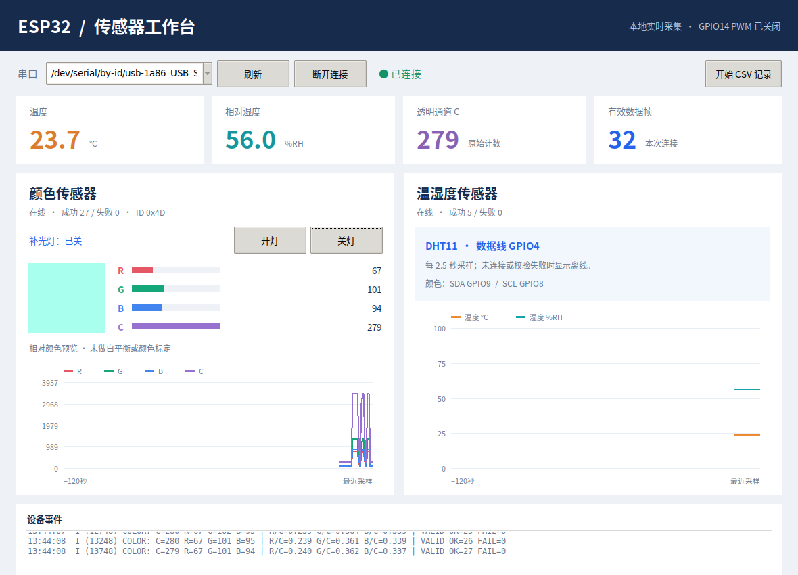
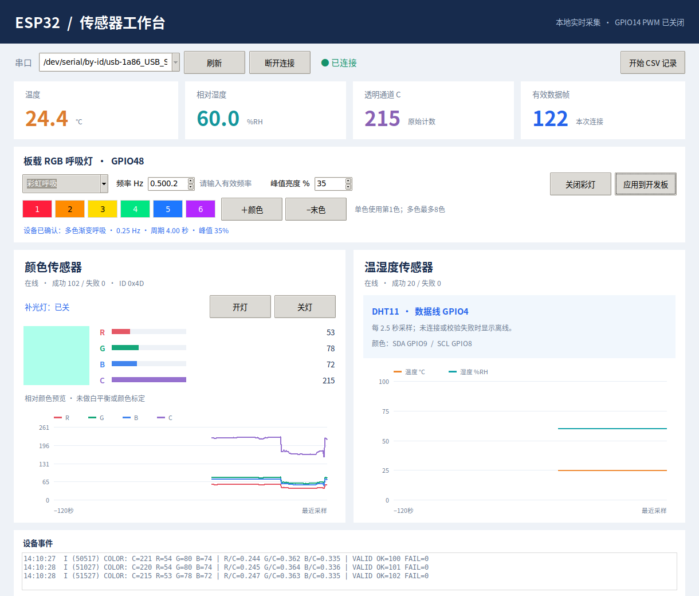
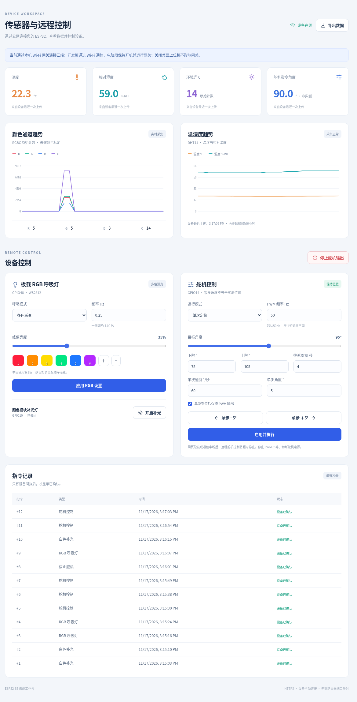
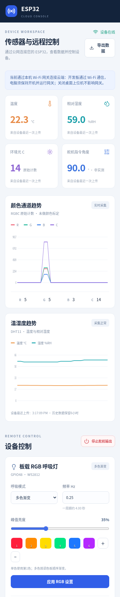

# ESP32-S3 物联网监测与控制台

用一块 ESP32-S3 采集温湿度、颜色和环境光，并控制补光灯、板载 RGB 呼吸灯和舵机。桌面上位机通过 USB 串口工作，网页端通过 HTTPS 显示实时数据、历史曲线和设备回执，也能从外网下发指令。

## 硬件与接线

| 硬件 | 用途 | 本项目接线 |
| --- | --- | --- |
| ESP32-S3-N8R8 开发板 | ESP-IDF 固件，8 MB Flash、8 MB PSRAM，2.4 GHz Wi-Fi | CH343 USB 转串口连接电脑 |
| DHT11 温湿度模块 | 温度和相对湿度 | DATA → GPIO4 |
| TCS3472 系列颜色模块 | RGBC 原始计数，I²C 地址 0x29；实物 ID 为 0x4D，对应 TCS34727 | SDA → GPIO9，SCL → GPIO8，VIN → 3.3 V，GND 共地 |
| 颜色模块白色补光灯 | 可独立开关 | LED → GPIO10，开漏控制 |
| 板载 WS2812 | 单色、多色渐变和彩虹呼吸 | GPIO48，已接在板上 |
| 180° 三线 PWM 舵机 | 单次定位、单步、持续往返 | 信号 → GPIO14，电源 → 5 V，GND 共地 |

引脚以实物为准。本项目的开发板默认把 5VIN 当电源输入，实板短接 IN-OUT 焊盘后才用板上 5 V 驱动舵机。其他板型需先核对原理图和供电能力，也可给舵机单独供电，电源地与开发板共地。网页显示的是舵机指令角度。

## 实际界面

**桌面上位机 · 实时曲线和补光控制**



**桌面上位机 · RGB 调色和呼吸频率**



**公网控制台 · 传感器、灯光、舵机和设备回执**



**手机浏览器 · 实时数据**



## 本地运行

1. 安装 ESP-IDF 6.1 系列，激活环境，在仓库根目录编译并烧录。请将串口路径改成自己的设备。
   ```bash
   idf.py -C projects/tcs34725 set-target esp32s3
   idf.py -C projects/tcs34725 -p /dev/ttyACM0 build flash
   ```
2. Ubuntu 上安装 Python 3 与 Tkinter，然后启动桌面上位机。
   ```bash
   python3 -m venv host/sensor-dashboard/.venv
   host/sensor-dashboard/.venv/bin/python -m pip install -r host/sensor-dashboard/requirements.txt
   bash tools/start-dashboard.sh --port /dev/ttyACM0
   ```
3. 查看[固件说明](projects/tcs34725/README.md)、[上位机说明](host/sensor-dashboard/README.md)和[网页后端说明](cloud/esp32-control/README.md)。

## 云端和公网部署

网页后端使用 TypeScript、React/Vinext 和 Cloudflare D1。部署时为后端配置 `DB` 绑定并应用 `drizzle/` 迁移，设置 `ADMIN_USERNAME`、`ADMIN_PASSWORD`、`DEVICE_KEY` 和 `DEVICE_ID`。示例设备 ID 为 `esp32-demo`。设置自己的高强度管理员密码和独立随机设备密钥，再用串口配置设备 Wi-Fi、后端 HTTPS 地址和设备密钥。

实际演示用电脑上的 HTTPS 网关转发设备数据，通过 Tailscale Funnel 提供浏览器公网入口。使用网关时，电脑要持续联网，并将自己的网关证书放到 `projects/tcs34725/main/gateway_ca.pem` 后重新编译。辅助网关和反代脚本中的示例地址要替换成自己的部署地址。直连模式要求后端入口接受嵌入式 HTTPS 客户端。

实板已验证数据上传、补光开关、RGB 切换、舵机单步和往返、远程指令回执及断联后停止 PWM。
